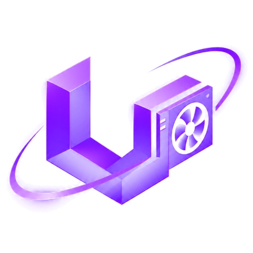
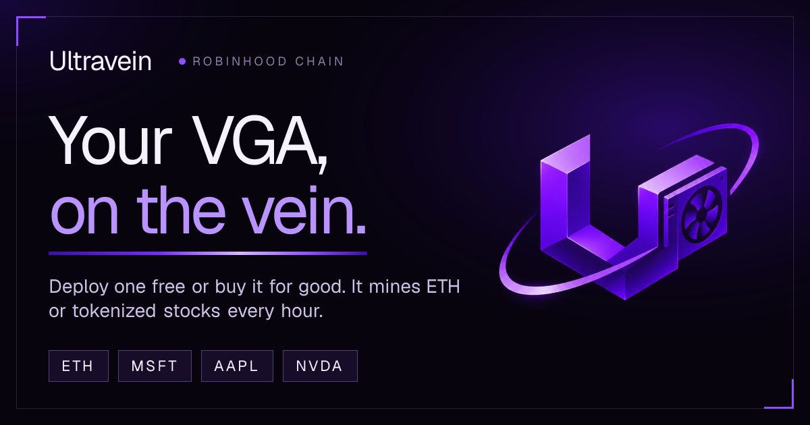
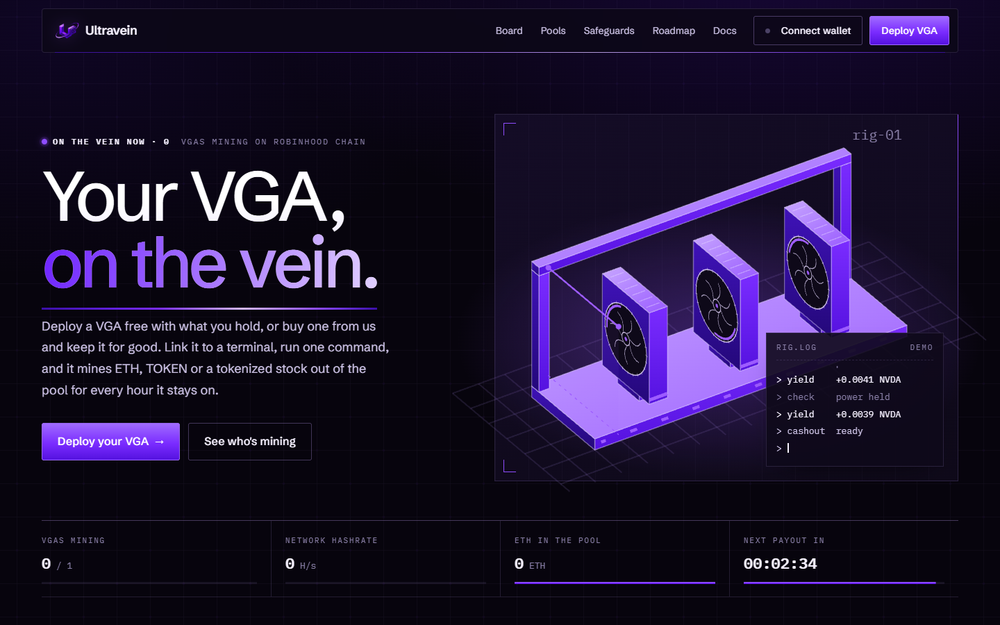
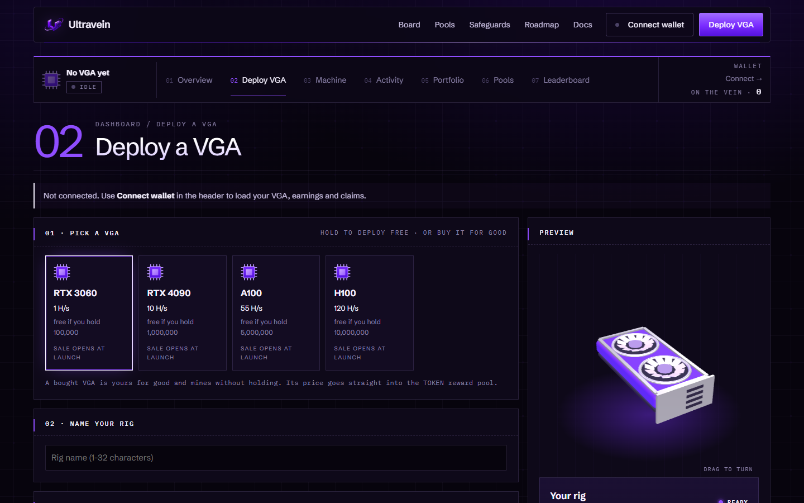

<p align="center">
  
</p>

<h1 align="center">Ultravein</h1>

<p align="center">
  <b>Your VGA, on the vein.</b><br />
  Deploy a virtual VGA on Robinhood Chain, switch it on from your terminal, and mine ETH or tokenized stocks every hour.
</p>

<p align="center">
  <a href="https://github.com/ultravein/ultravein-protocol/actions/workflows/ci.yml"></a>
  
  
  
  
</p>

<p align="center"></p>

---

## What it is

| | |
|---|---|
| **A VGA, without the hardware** | Every VGA is virtual and runs on the network. Four tiers, from RTX 3060 to H100. |
| **Two ways to get one** | **Hold** the token and the VGA your balance covers is free to run. Or **buy** one from the shop, keep it for good, and mine with no holding at all. |
| **Switched on from a terminal** | `node rig.mjs start` is the power button. The rig earns for every second it stays on; close the terminal and it stops. |
| **Paid in real assets** | Each pool pays in its own asset: ETH, the project token, or tokenized MSFT, AAPL, NVDA. No swap, no reward token. |
| **Bounded by the contract** | One contract, no proxy. Payouts settle as merkle roots with a 5%-per-day release cap, a 30-minute veto and a 48-hour public withdraw timelock. |
| **Every shop sale refills the pool** | 100% of a VGA's price lands in the token reward pool and is paid back out to miners. |

<table>
  <tr>
    <td></td>
    <td></td>
  </tr>
  <tr>
    <td align="center"><sub>Home</sub></td>
    <td align="center"><sub>Deploy VGA: pick or buy a card, link a terminal</sub></td>
  </tr>
</table>

## How it works

```
  get a VGA ──▶ deploy the rig ──▶ link a terminal ──▶ run it ──▶ hourly settle ──▶ claim
  hold or buy    wallet signs        init + code         heartbeat    merkle root      per asset,
                 name/VGA/vein       wallet signs        every 5 min  30 min veto      any time
```

1. **Get a VGA.** Hold the token for a free one, or call `buyCard(tier)` to own one forever.
2. **Deploy your rig.** Pick a name, the VGA and the asset it mines (its *vein*). One signature, no gas.
3. **Link a terminal.** `node rig.mjs init <site>` prints a code like `UV-8K2F-QX7M-41PD`; paste it on the Deploy VGA tab and sign.
4. **Run it.** `node rig.mjs start` sends a signed heartbeat every 5 minutes. Each one keeps the rig mining for the next 10.
5. **Settle.** Every hour, each pool releases 0.1% of what is left in it, split between online rigs by `hashrate × seconds online`. Totals go into a cumulative merkle root.
6. **Claim.** After the root's 30-minute veto window, claim each asset from Portfolio. One claim collects everything owed so far.

## VGA tiers

| Slot | VGA | Hashrate | Hold for free | Buy | H/s per 1M held |
|---|---|---|---|---|---|
| 01 | RTX 3060 | 1 H/s | 100,000 | set by owner at launch | 10.0 |
| 02 | RTX 4090 | 10 H/s | 1,000,000 | set by owner at launch | 10.0 |
| 03 | A100 | 55 H/s | 5,000,000 | set by owner at launch | 11.0 |
| 04 | H100 | 120 H/s | 10,000,000 | set by owner at launch | 12.0 |

- **Held** VGAs are checked every hour against your **lowest** balance in that hour. A dip mid-hour counts for the whole hour.
- **Bought** VGAs skip the check. Upgrading pays only the difference over what you already paid.
- Your rig runs the best VGA you own or can hold, never one above the VGA you picked.
- Bigger VGAs never pay less per token held, so splitting one bag across wallets never earns more.

## Run your rig

```bash
curl -fsSLo rig.mjs https://<site>/rig.mjs    # one file, Node.js 18+, zero dependencies
node rig.mjs init https://<site>              # prints UV-XXXX-XXXX-XXXX → paste on Deploy VGA
node rig.mjs start                            # mines while this stays open
```

```
  ultravein rig  ni6TubA7t3…  https://app.example

  rig      vesper  ·  H100
  status   ● mining NVDA   120 H/s
  rate     ~0.0041 NVDA / hour
  earned   0.0213 NVDA   (claim on the dashboard)
  payout   next in 00:41:12
  uptime   03:12:40

  heartbeat in 288s · Ctrl+C to stop (mining stops within 10 min)
```

The node key in `~/.ultravein/rig.json` holds no funds and cannot claim, buy or change your rig; it only proves the terminal is running. More in [`docs/TERMINAL.md`](docs/TERMINAL.md) and [`rig/README.md`](rig/README.md).

## Rewards, exactly

```
released(asset, hour)  = remaining(asset) × 0.1%
weight(rig)            = hashrate(effective VGA) × seconds online in the hour
share(rig)             = released × weight / Σ weight of rigs on that asset
```

| Guarantee | Enforced by |
|---|---|
| No root commits more than 5% of a pool per day | `MiningPool.publish` (`RELEASE_BPS_PER_DAY = 500`) |
| A bad root can be stopped | 30-minute `CHALLENGE_DELAY`, guardian `veto` |
| Owed rewards can never be withdrawn | `executeWithdraw` is limited to `unallocated(asset)` |
| Withdrawals are public and slow | 48-hour `WITHDRAW_DELAY`, events on chain |
| Signatures cannot be replayed | timestamp within 5 min and newer than the last accepted one |
| No hidden upgrade | no proxy, no `delegatecall` |

## Repository

```
ultravein-protocol/
├── .github/workflows/
│   ├── ci.yml              contracts (forge) · web (tsc, vitest, build) · rig (sync check)
│   └── epoch.yml           hourly settlement call (needs SITE_URL + CRON_SECRET secrets)
├── assets/                 logo, banner and screenshots for this README
├── contracts/              Foundry project
│   ├── src/MiningPool.sol  pools, merkle claims, VGA shop, timelocked admin
│   ├── test/               24 tests
│   └── script/             Deploy.s.sol, verify-blockscout.mjs
├── docs/
│   ├── ARCHITECTURE.md     components, rig lifecycle, the hourly job, KV keys
│   ├── CONTRACT.md         MiningPool reference
│   ├── API.md              every endpoint and signed message
│   ├── TERMINAL.md         holder's guide to running a rig
│   └── DEPLOY.md           wallets, contract, shop, Vercel, hourly cron
├── rig/
│   ├── rig.mjs             terminal client (source)
│   └── README.md           commands and node protocol
├── web/                    Next.js 16 app
│   ├── app/                home, dashboard (/app), docs (/docs), API routes, 3D and SVG figures
│   ├── lib/                chain, epoch job, mining math, merkle, auth, node keys, KV
│   ├── public/rig.mjs      the copy the site serves (kept identical by CI)
│   ├── scripts/            fork end-to-end and seed scripts
│   └── test/               vitest: auth, block search, config, merkle, mining math, node signatures
├── LICENSE · SECURITY.md · package.json · .editorconfig
```

## Quickstart (local)

Requirements: Node.js 22, [Foundry](https://book.getfoundry.sh/).

```bash
git clone https://github.com/ultravein/ultravein-protocol && cd ultravein-protocol

# contracts
cd contracts
forge install foundry-rs/forge-std@v1.16.2 OpenZeppelin/openzeppelin-contracts@v5.7.0 --no-git
forge test
cd ..

# web
cd web && npm install
cp .env.example .env.local      # works without a pool: pages render with empty pools
npm run dev                     # http://localhost:3000
```

Without Upstash credentials the API stores its state in `web/data/kv.json`. If your network blocks the public Robinhood Chain RPC, set `RH_RPC` to another endpoint.

From the repo root: `npm test` runs the contract tests, the web tests and the rig sync check.

## Dashboard

| Tab | What it is for |
|---|---|
| 01 Overview | Your VGA in 3D, balance, estimated hourly rate, earnings chart, terminal status and uptime blocks |
| 02 Deploy VGA | Pick or buy a VGA, name the rig, choose the vein, link a terminal |
| 03 Machine | The four VGAs in 3D, what your rig runs as, gate checks, the hourly filter |
| 04 Activity | Minutes online per hour, timeline, per-epoch table |
| 05 Portfolio | Earned, claimable and claimed per asset; claim buttons |
| 06 Pools | Pool levels, buckets, network hashrate |
| 07 Leaderboard | Every rig online, strongest VGA first |

## API at a glance

| | Endpoint |
|---|---|
| Read | `GET /api/stats` · `/api/network` · `/api/me?address=` · `/api/history?address=` · `/api/proof?address=&asset=` |
| Wallet-signed | `POST /api/agent` (deploy rig) · `POST /api/node/link` (link terminal) |
| Node-signed | `POST /api/node/init` · `POST /api/node/beat` |
| Operator | `POST /api/epoch/run` (bearer `CRON_SECRET`) |

Full shapes and signed texts: [`docs/API.md`](docs/API.md).

## Deploy

Short version (details in [`docs/DEPLOY.md`](docs/DEPLOY.md)):

1. Four fresh wallets: deployer, owner, publisher (server hot key), guardian.
2. `forge script script/Deploy.s.sol` with `OWNER_ADDRESS`, `PUBLISHER_ADDRESS`, `GUARDIAN_ADDRESS` (and `TOKEN` once it exists).
3. After the token launches: `setAsset(token, true)` and `setShop(token, prices)`.
4. Fund pools with `fund(asset, amount)`.
5. Deploy `web/` to Vercel with the env vars in `web/.env.example` and an Upstash Redis integration.
6. Add `SITE_URL` and `CRON_SECRET` repository secrets so `epoch.yml` settles every hour.

## Security

The off-chain job is trusted to compute fairly; the contract bounds what a wrong job can do (release cap, veto, public tree, timelocked withdraw). Read [`SECURITY.md`](SECURITY.md) for the trust model and how to report a vulnerability.

Tokenized stocks are not available to US persons.

## Roadmap

- [x] MiningPool with per-asset pools, capped merkle settlement, veto and timelocked withdraw
- [x] VGA shop: buy once, keep forever, paid into the pool
- [x] Terminal rigs: `rig.mjs`, pairing codes, signed heartbeats
- [x] Dashboard with 3D VGAs, docs, hourly job
- [ ] Token launch and shop prices
- [ ] Mainnet pools funded
- [ ] Open builder API

## License

[MIT](LICENSE)
